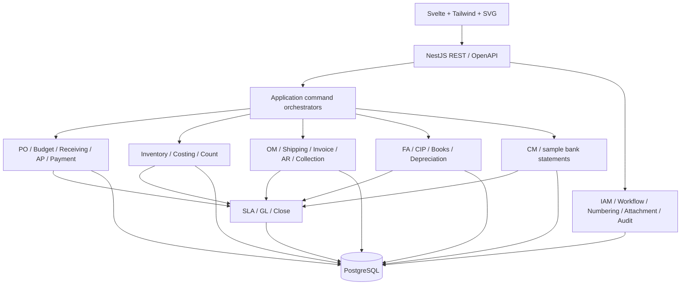
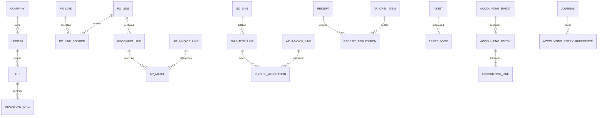

# Architecture & logical data model

## Boundary

หนึ่ง NestJS deployment และ PostgreSQL ต่อ environment schema แยกเป็น `iam`, `org`, `master`, `budget`, `purchasing`, `inventory`, `sales`, `shipping`, `ar`, `collection`, `ap`, `assets`, `cash`, `sla`, `gl`, `audit` บริการเจ้าของข้อมูลเป็นผู้เขียน ไม่ให้ module อื่นข้ามไปแก้ตารางโดยตรง Reporting อ่าน scoped views ได้

Service orchestration รับ transaction context เดียว ไม่เปิด transaction แยกในแต่ละ service ซึ่งอาจ commit ก่อนขั้นตอนอื่นสำเร็จ REST endpoints เรียก application command; module-to-module ใช้ in-process service interfaces ไม่มี HTTP เรียกตนเอง ไม่มี outbox/event bus

## Entity catalogue

ชื่อเป็น logical entities ไม่ใช่ DDL migration ที่เริ่ม implement แล้ว

| Owner | Entities และ Key relationships |
| --- | --- |
| Org/IAM | Company, LegalEntity, Ledger, OU, InventoryOrg, Subinventory, Locator; User, Role, Permission, ScopeGrant, WorkflowDefinition/Version, ApprovalInstance/Step |
| Master | Customer/Site, Supplier/Site/Bank, Item, UOMConversion, PriceList/Line, PaymentTerm, TaxCode/Version, AccountCombination |
| Budget | BudgetVersion → BudgetLine (company/OU/fiscal-year/period/cost-center/account/category); BudgetReservation → ReservationMovement; BudgetChangeRequest |
| PO/AP | PR/PRLine → POLineSource → PO/POLine; Receiving/ReceivingLine → ReceiptDistribution → APInvoiceLineMatch → APInvoice/Line; Payment → PaymentApplication; SupplierCredit/Return |
| Inventory | StockMovement (source line, signed qty/value), StockBalance (org/item/locator), Reservation, Transfer/TransferLine, CostBucket (org/item), CostAdjustment, CountSession/Line/Attempt/Variance |
| OM/Shipping | Quotation/Line → SO/Line; CreditReservation; Allocation → Pick/PackLine → Shipment/ShipmentLine → ShipmentSource; DeliveryAttempt, PODAttachment |
| Billing/AR | ARInvoice/Line → InvoiceShipmentAllocation (qty/value); AROpenItem; Receipt → ReceiptApplication; CreditMemo/Line → CreditApplication; Return/Line → ReturnDisposition |
| Collection | CollectionCase → CaseInvoice, ContactActivity, PromiseToPay, Dispute; BillingBatch → BillingBatchInvoice |
| FA | CapitalizationSource(AP distribution) → AssetCostAllocation → Asset; CIPProject/Cost/Allocation; AssetBook, DepreciationRun/Line, AssetTransfer, AssetCount, Retirement |
| CM | BankAccount (LegalEntity owner/OU access), BankStatement/Line, ReconciliationGroup/Match/Adjustment |
| SLA/GL | AccountingEvent → AccountingEntry/Line (rule-version, source); Journal/Line → AccountingEntryReference; FiscalPeriod/ModulePeriod, CloseRun/Check, YearCloseRun, OpeningBalance |
| Reports | FinancialMappingVersion/Line, ReportRun, FinancialPack/Snapshot, SupplementalSchedule, ReviewSignoff |
| Control | IdempotencyRecord, DocumentSequence, AuditEntry, AttachmentReference; no integration dispatch queue |

Cardinality แสดงเฉพาะโครงหลัก Company/LegalEntity/Primary Ledger/OU เป็นไปตาม P11 ที่ยืนยันแล้ว ไม่สมมติ Company=OU ทุกกรณี

## Constraints และ concurrency

- Scoped identity: company/ledger/OU/org ของ line สืบทอด header และตรวจความสัมพันธ์ ห้ามรับ scope จาก browser โดยไม่ตรวจสิทธิ์
- Document number unique ตาม scope/pattern/fiscal-year; sequence atomic; revision number + optimistic version ตรวจ stale edit
- Money ใช้ decimal fixed precision (amount numeric(20,2), quantity/unit cost numeric(24,6)); API ส่งเป็น string ไม่คำนวณยอดลงบัญชีด้วย JS floating point; precision/rounding ตั้งค่าตาม P08 ที่ยืนยันแล้ว
- FK และ unique source allocation ป้องกันรับ/ส่ง/ออกบิล/ตั้งหนี้เกินยอด ไม่ใช้แค่ check frontend
- Lock budget bucket, credit bucket, stock bucket และ open-item ก่อนใช้ยอด; lock resource ชนิดเดียวกันเรียง key เดียวกันเพื่อเลี่ยง deadlock
- AccountingEvent unique `(company, source_type, source_id, source_revision, event_type)`; journal posting/reversal/year-close unique ต่อ source operation
- IdempotencyRecord ผูก user/scope/command/key/request hash กับผลสำเร็จใน transaction เดียว คีย์เดิม payload ต่าง → 409; ไม่ใช่ Outbox
- ห้ามแก้ stock movement, posted journal หรือ applied settlement ย้อนหลังโดยตรง ใช้ linked compensating documents
- หลังส่งตรวจ เก็บ snapshot รายการ/ราคา/tax/rule-version; การแก้สาระสำคัญสร้าง revision และ invalidate approval
- Audit append-only สำหรับ app role; owner/admin database ยังมีอำนาจ จึงไม่อ้าง tamper-proof ต่อ DBA

## Stock/Cost model

On-hand เป็นจำนวนตาม location; available = eligible on-hand - active reservation - policy holds ต้องแยก inspection/in-transit/non-valued locations เพื่อไม่ double count สินค้าอยู่ระหว่างโอนไม่พร้อมขายที่ปลายทาง การโอนข้าม Org มี shipment/receipt คู่กันและ valuation policy ที่ P07

Valuation bucket ระดับ Org+Item; movement quantity สะสมแยก locator แต่ไม่คำนวณ average cost แยก locator เมื่อรับที่เข้าเกณฑ์: `(old_value + receipt_value)/(old_qty + receipt_qty)` คำนวณ precision สูงแล้วจัดการ rounding residual ตามนโยบาย กรณี qty=0 ไม่หารด้วยศูนย์ Costing รับราคา AP ที่เปลี่ยนภายหลังผ่าน adjustment ที่อ้าง source receipt; ห้ามนำผลต่างทั้งหมดไปเพิ่ม current stock หากสินค้าบางส่วนขายแล้ว ต้องแยก inventory/COGS/variance ตาม P07

## Accounting design

SLA rule versions มี effective dates, source distribution, account mapping, tax/amount source และ rounding policy พรีวิว entries ต้อง balance ก่อน post ทุก source มีสถานะ `ACCOUNTED` หรือ unresolved exception ชัดเจน ไม่ปล่อยธุรกรรม stock/settlement สำเร็จแต่ SLA หาย

สำหรับ final command ที่เปลี่ยนมูลค่า (Ship Confirm, accept receipt, post invoice, finalize payment/count) ให้สร้าง accounting evidence/SLA/GL ที่จำเป็นใน transaction เดียว หาก mapping ไม่พร้อมให้ rollback final command; ผู้ใช้บันทึก draft และแก้ exception ก่อน final ได้ การแยก draft operation ออกจาก final posting ต้องระบุที่หน้าจอ

แนวคู่บัญชีตาม **P12 ที่ยืนยันแล้ว** (รหัสบัญชีจริงตั้งค่าผ่าน Mapping): receipt Dr Inventory/Cr GRNI; matched AP Dr GRNI (+ VAT/variance)/Cr AP; shipment Dr COGS/Cr Inventory; AR invoice Dr AR/Cr Revenue (+ Tax); payment/receipt ใช้ clearing account จน reconcile; depreciation Dr Expense/Cr Accumulated Depreciation การรับรู้รายได้ต้องยึด P03 ไม่ถือ ship date เป็น revenue date ทุกกรณี

## Financial statements

TB มี opening, period debit, period credit, closing โดย opening ใช้ balance snapshot บวก posting ถึงก่อนงวด ไม่ double count closing/opening journals ของปีเดิม Report ทุกตัวบังคับ company/ledger และ fiscal scope Financial Pack เก็บ mapping version, source cutoff, generation version และ supplemental schedules พร้อม sign-off งบกระแสเงินสด/Equity ไม่อ้างว่าได้ถูกต้องจาก TB อย่างเดียว P10 ยืนยัน indirect พร้อม comparative data และ supplemental schedules แล้ว

## Runtime ที่เสนอ

Docker Compose: web, api, postgres และ local attachment volume ไม่เปิดระบบเก่า 8088/5432 ทับ ระบุพอร์ตใหม่เมื่อเริ่ม implement Authentication ทำ interface รองรับ OIDC แต่ local user/session และวิธี production identity เป็น configuration สำหรับสภาพแวดล้อม local/production โครงนี้ไม่เริ่ม provision IdP หรือเปิด network ใหม่

## Authorization matrix ตามแบบที่ยืนยันแล้ว

Role names เป็นแบบออกแบบ ปรับ assignment/วงเงินจริงตาม D07/P08 ไม่ให้ Admin ได้สิทธิ์อนุมัติธุรกรรมทุกอย่างโดยอัตโนมัติ

| บทบาท | ทำรายการ | อนุมัติ / final action | ข้อจำกัด |
| --- | --- | --- | --- |
| Requester / Buyer | PR / PO draft, revision | ตาม approval route ที่ได้รับ | คนสร้างไม่อนุมัติเอกสารตนเอง |
| Budget owner | งบ/คำขอเพิ่มโอน | budget/PR limit ตาม OU | ไม่ใช้สิทธิ์แก้ยอด reservation โดยตรง |
| Receiver | receiving / inspection | accept ตามสิทธิ์ | จำนวน/Org ไม่เกินที่อนุญาต |
| Stock controller / approver | transfer / count / recount | count variance approval แยกคน | blind-count data และ freeze ตาม P01 ที่ยืนยันแล้ว |
| Sales | quotation / SO | ขอ GP/credit exception | ไม่ปลด hold หรือเพิ่มเครดิตตนเอง |
| Credit approver | credit review | approve credit/hold release | scope+reason+amount authorization |
| Shipping | pick / pack / shipment | ship confirm | ไม่แก้ invoice/AR โดยตรง |
| AP / AR accountant | invoice / match / memo / receipt draft | final account ตาม route | bank/settlement แยกสิทธิ์ที่สำคัญ |
| Collector | contact / promise / dispute / billing | collection follow-up | เปลี่ยนยอดหนี้/รับเงินผ่าน contact action ไม่ได้ |
| Treasury | payment / receipt / reconciliation | finalize ตามวงเงิน | จ่ายซ้ำไม่ได้; reversal จำกัดสิทธิ์ |
| Asset accountant / manager | capital/CIP/run/transfer/retire | approve/post แยก maker | Tax Book ไม่สร้าง GL ซ้ำ |
| GL accountant / manager | journal/mapping/close preview | approve/post/close/finalize | ผู้ทำรายการไม่อนุมัติตนเอง; scope ทุก report |
| System Admin | users/config/scopes | access administration | ไม่เป็น financial approver โดยปริยาย |
| Auditor | read/export/audit | ไม่มี financial write | ledger/OU scopes ยังบังคับ |

Supplier bank details ใช้ผู้ดูแลที่ได้รับมอบหมาย แยกจากผู้สร้าง Supplier เก็บ masked display และ audit ที่ไม่เปิดเลขบัญชีเต็มแก่ทุกบทบาท ไฟล์ตัวอย่างไม่ใช้ bank credentials จริง Approval delegation ต้องเก็บช่วงเวลา/ผู้มอบ ไม่ปล่อยให้เป็น self approval ทางอ้อม
