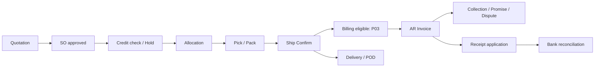

# Workflows & transaction boundaries

สถานะและนโยบายต่อไปนี้ยึด P01–P12 ซึ่งผู้ใช้ยืนยันทั้งหมดแล้วใน 01-scope-decisions.md

## P2P / Budget / Inventory

`PR DRAFT → SUBMITTED → APPROVED/RETURNED → PO ALLOCATED → CLOSED/CANCELLED`

`PO DRAFT → SUBMITTED → APPROVED → PART_RECEIVED → RECEIVED → CLOSED`

1. PR approval ตรวจสิทธิ์/วงเงินและจอง budget bucket ภายใน transaction เดียว หากเกิน Absolute rollback approval/reservation
2. Convert PR→PO lock source lines และ budget reservations แล้วโอน commitments เฉพาะจำนวนที่ใช้ ไม่ถือ PO เป็น budget ใหม่อีกก้อน
3. Receiving draft บันทึก actual quantity, inspection, destination; accept/put-away ปรับ received quantity, stock, cost และ SLA พร้อมกัน เมื่อ receipt ต้อง approval ให้ stock ยังไม่ available จนขั้นที่เกี่ยวข้องสำเร็จ
4. Matching แยก PO/Receipt/Invoice quantities และราคา ให้ Hold เมื่อเกิน tolerance; AP posting ตั้งหนี้พร้อม SLA ปริมาณคืน/ยกเลิกต้องหักจาก matching capacity
5. Payment proposal ไม่ถือจ่ายจริง; finalize payment จำลอง lock unpaid balance และสร้าง application/clearing/SLA พร้อมกัน ป้องกันสองคนจ่าย invoice ก้อนเดียวกัน
6. Return supplier อ้าง receipt และจำนวนคืนได้จริง ปรับ stock/cost กับ supplier credit/claim และบัญชีตาม P07 ไม่ลบ receipt เดิม

Available budget เป็น approved budget + approved changes - active encumbrance - actual ที่ไม่ซ้ำกัน PR reserve โอนไป PO; invoice actual conversion ใช้ P05: AP ผ่านบัญชี ต้องทดสอบกรณี partial receipt/invoice, price variance, cancelled PO และ credit note ไม่หักงบทั้ง receipt+AP+GL ซ้ำ

## O2C / Shipping / Invoice / AR

SO approval ตรวจราคา/GP และเครดิต lock customer credit bucket; ช่วงคำนวณ exposure ต้องย้าย commitment ไป AR ตอน invoice posting แบบไม่ซ้ำ ไม่ตัด commitment ทิ้งตอน ship confirm หากยังไม่เกิด AR ให้มี unbilled exposure ต่อเนื่อง

Allocation จอง eligible available stock ไม่ลด physical on-hand Pick/Pack เก็บจำนวนตาม line; Ship Confirm lock reserved/on-hand และลดทั้ง stock/reservation พร้อมบันทึก COGS/SLA และ shipped qty ป้องกัน confirm ซ้ำ POD เปลี่ยน delivery status ไม่ตัด stock ซ้ำ Shipping return ใช้ return authorization/inspection/disposition ก่อนคืนสินค้าพร้อมขาย

Invoice eligibility P03 และ grouping P02 ยืนยันแล้ว ลิงก์แต่ละ invoice line ถึง shipment allocation; lock billable quantities ขณะออก invoice เพื่อกันคนละหน้าจอออกบิลซ้ำ เก็บ net/tax/gross, due date และ price/tax snapshots

Receipt Application ลด AR ตามเงินจริงเฉพาะ allocated amount; money unapplied ไม่ลดยอด invoice นัดชำระ/Contact/Dispute ไม่ post GL และไม่ลด exposure อัตโนมัติ หากต้อง credit hold exception ต้องมี explicit approval

Credit/Debit Memo อ้าง invoice/เหตุผล/ผู้อนุมัติ; คืนสินค้าทางกายภาพกับลดหนี้เป็นสอง operation ที่เชื่อมกันได้ แต่อย่าเพิ่มสต็อกจาก financial-only memo

## Inventory count / adjustment (P01 confirmed)

`DRAFT → SCOPE_FROZEN → COUNTING → REVIEW → RECOUNT/APPROVED → ADJUSTED → CLOSED`

แยกรอบสินค้าจากการนับทรัพย์สิน FA; attempt แต่ละครั้ง immutable; Blind Count ต้องไม่ส่ง expected qty กลับ API ผู้ตรวจนับ รวม export; freeze ต้องบังคับ receiving/shipping/transfer ทุกเส้นทางที่แตะ scope นั้น ไม่เพียงปิดปุ่มในหน้าจอนับ

อนุมัติผลต่างต้องคนละคนกับผู้บันทึก Atomic adjustment สร้าง stock/value deltas และ SLA/GL พร้อม status ADJUSTED; second submit คืนผลเดิม ไม่ปรับซ้ำ กรณีผลนับน้อยกว่ายอดจองต้องระบุวิธียกเลิก/จัดสรรใหม่ก่อน final ไม่ทำ available ติดลบเงียบ ๆ

## FA

`AP capital source → CAPITALIZATION_PENDING → Asset / CIP → IN_SERVICE → TRANSFERRED / RETIRED`

Capitalization allocation แยก AP distribution ไปหลาย asset ได้แต่ sum ไม่เกิน available cost ห้าม register ต้นทุนเดิมซ้ำ Corporate/Tax Books แยกวิธีและ rule versions; preview depreciation ไม่เปลี่ยน balance; finalize corporate run lock asset-book-period แล้วสร้าง depreciation lines/SLA/GL พร้อมกัน Tax run เก็บผลคำนวณไม่สร้าง GL ซ้ำ

CIP transfer → asset cost allocation รักษาผลรวมและ evidence; accumulated depreciation และ NBV จาก posted corporate movements; residual/remaining cost จำกัดไม่ให้ depreciation เกิน depreciable amount P09 ใช้ daily convention ตามการตั้งค่า Asset Book และตรวจ boundary ใน UAT Retirement คำนวณ cost/accumulated/NBV/proceeds/gain-loss และ linked approval ห้ามลบทะเบียนที่มีบัญชีแล้ว

## SLA / GL / Closing

SLA preview `DRAFT → VALIDATED / EXCEPTION`; final posting `VALIDATED → POSTED` แบบ source version เดียว; Journal manual `DRAFT → SUBMITTED → APPROVED → POSTED → linked reversal`

Recurring/Allocation เริ่มจาก template version → preview run → approval/post; unique template-period-run-key, source/destination sums ต้องตรง มี STAT/driver evidence; ไม่ rerun overwrite posted allocation

Module periods ของ AP/AR/CM/INV-COST/FA ต้องพร้อมก่อน GL close โดย Inventory ตรวจทุก relevant Org ส่วน Financial Pack แยก company/ledger เสมอ

1. ตรวจ draft/unposted/unaccounted/holds, stock/value mismatches, AR/AP control, bank differences, FA↔GL
2. ปิด subledger modules; lock period states กับ final posting เพื่อป้องกัน race ระหว่าง check กับ close
3. เปิด adjustment 13/14 ตามสิทธิ์ ลง auditor adjustments และกระทบยอดใหม่
4. GL close ทำ TB snapshot และ financial pack draft พร้อม Mapping/version/cutoff
5. Review/sign-off → Final; source/mapping เปลี่ยนต้องสร้าง pack revision ใหม่ ชุด final เดิมยังอยู่
6. Year close lock company/year และสร้าง retained earnings/opening batch แบบ unique; policy ยกยอด P&L/balance accounts และ reopen ใช้สิทธิ์/เหตุผล/Audit ตาม P12 ที่ยืนยันแล้ว ห้ามอ้างผลลัพธ์ “ปิดถาวร” หากยังมี reopen route โดยไม่มีควบคุม

## Error และขอบเขต atomicity

Synchronous final command ที่เปลี่ยน stock/balance/GL ต้องสำเร็จทั้งหมดหรือ rollback ทั้งชุด Idempotency+optimistic versions ยังจำเป็นแม้ localhost เพราะ refresh/double-click/หลายแท็บเกิดได้ File upload/report generation ไม่อยู่ใน DB atomicity ใช้ temporary file → validated metadata → finalize และเก็บ failed/orphan cleanup status โดยไม่เรียกว่า outbox

ไม่มีการเรียกธนาคาร/ส่งอีเมลจริงใน final DB transaction รุ่นนี้ adapter sample ใช้สร้าง/import test evidence เท่านั้น ทุก reject มี rule code, field/line และ recoverable action; retry ใช้ explicit command ไม่ทำ hidden background delivery
